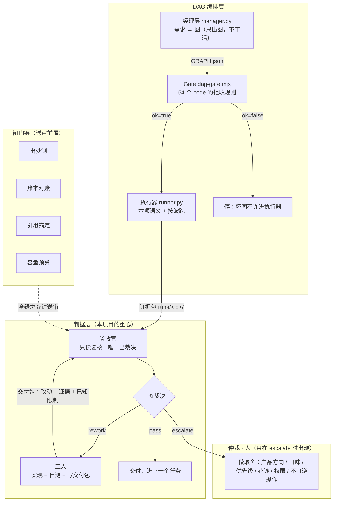
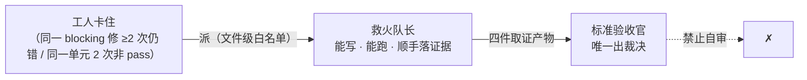
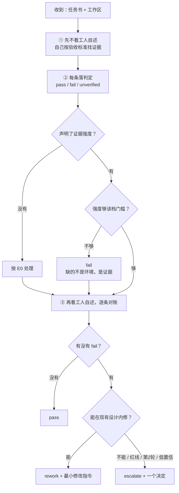
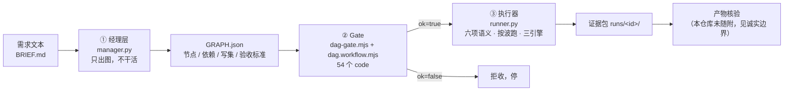
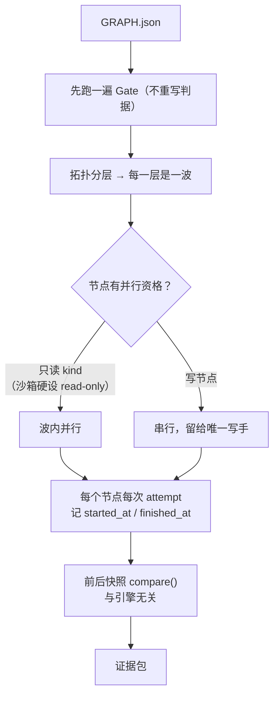
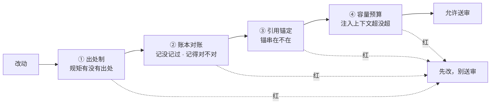

# 架构

> 这份文档讲**判据的形状**，不讲某个函数的实现。想看实现读 `src/` 与 `engine/`；
> 想看「接口长什么样」读 [`CONTRACT.md`](CONTRACT.md)；
> 想看「为什么非得这样」读 [`REVIEW-CONTRACT.md`](REVIEW-CONTRACT.md) 与 [`PLAN.md`](PLAN.md)。
>
> 四层从外到内：**三权分立**（谁有资格下结论）→ **三态裁决**（结论只能长哪三样）→
> **DAG 三层**（一件大事怎么拆给多个 AI 并行干）→ **闸门链**（送审之前先过哪几道机械检查）。
> 前两层是**判据**，第三层是**编排**，第四层是**防自欺**。

---

## 零、全景



---

## 一、三权分立

### 1.1 三个位

| 角色 | 谁 | 能做什么 | **不能做什么** | 它的证据责任 |
|---|---|---|---|---|
| **工人** | 执行任务的 AI（任意模型） | 实现、改文件、跑命令、自测、写交付包（改动 + 证据 + 已知限制） | **不给自己发合格证**；不把自己的「已验证」当结论 | 声称「已修复 / 已验证」时必须给命令输出或 `file:line` |
| **验收官** | 独立会话的另一个模型（后端可插拔：`codex` 或任意 OpenAI 兼容 API） | 读文件、跑**只读**命令、逐条对账、出三态裁决 | **不写工作区**（纪律，非沙箱隔离）；不替人做产品 / 口味 / 花钱的决定；不复述工人自述当证据 | 每条判定必须能被别人重跑；判不了就写 `unverified`，**不许算 pass** |
| **仲裁** | 人 | 在 `escalate` 时做一个决定 | 不逐条 review 日常交付 | —— |

**这套分工要解决的不是「AI 会不会偷懒」，而是「AI 无法独立于自己」**：
同一个上下文里既实现又验收，验收的输入就是实现时形成的判断，它没有第二个视角可用。
把验收官放进**独立对话、独立上下文、只读纪律**里，才有可能拿到真正独立的第二个视角。

> ⚠️ **「只读」的准确定义：纪律 + 事后可核，不是沙箱隔离。**
> 它约束的是「验收官不写工作区」这条行为约定；它**不提供**进程级 confinement
> （越界写入技术上做得到，只能靠前后快照事后发现）。
> 之所以不干脆用 `read-only` 沙箱：Windows 上那等于**禁止执行任何命令**，连读文件都被挡，
> 验收官会退化成「判任务书叙述层」。代价与执行层细节见 [`CONTRACT.md`](CONTRACT.md) §5.1。

### 1.2 为什么必须三角，不是两角

两角（工人 + 验收官）有一个结构性死锁：**验收官说啥都算的话，它自己就成了新的单点。**

- 它说 `pass` → 谁保证它没顺从？（LLM 通病）
- 它说 `rework` → 谁保证这条返工不是在挑口味？
- 它说「我验不了」 → 活就永远卡在那了。

所以第三角是必须的：**给「说不清」一条合法出口**（`escalate`），
让验收官不必为了推进而勉强判决。这条出口的代价是「麻烦人」，收益是**它不必撒谎**。

### 1.3 救火队长 —— 三权之外的第 4 个位



| 维度 | 验收官 | **救火队长** |
|---|---|---|
| 权限模型 | 只读（**行为约定 + 事后快照核**，见下文「已知弱点」） | **能写**，但写面是**文件级白名单** |
| 能否自审 | —— | **绝对不能**：产物一律送标准验收官 |
| 能改什么 | 什么都不改 | 白名单内的文件 + 新建产物目录；**判据类文件点名禁改**，`git` 写操作全禁 |
| 它的价值 | 独立第二个视角 | 不是「更会写代码」，而是**干活时顺手把可核证据产出来** |

> 触发规则、白名单格式、止损线（自动修复 3 次不成 → 找人）见 [`TRIGGER-POLICY.md`](TRIGGER-POLICY.md) §二·五；
> 事故单模板见 [`INC-TEMPLATE.md`](INC-TEMPLATE.md) 与 [`templates/INC-TEMPLATE.md`](../templates/INC-TEMPLATE.md)。

---

## 二、三态裁决

### 2.1 三态定义与后果

| 裁决 | 触发条件（全部满足） | 后果 | 谁承担下一步 |
|---|---|---|---|
| **`pass`** | 验收清单**每一条**都有可复现证据（`file:line` / 命令输出），且无 blocking | 交付，进下一个任务 | 工人 |
| **`rework`** | 有项不成立，但**能在现有设计内修**：改代码、补测试、补文档；不动钱、不动权限、不动发布、不删数据、不涉及主观口味 | 带**最小修改指令**打回，最多 2 轮 | 工人 |
| **`escalate`** | 命中六条红线之一（见 2.3），或第 2 轮仍 `rework`，或验收官 confidence < 0.6 | 打包成一封「**你要做的一个决定**」（二选一 / 三选一 + 各选项后果） | 人 |

**三态之外没有第四种。** 不接受「基本可以」「大致没问题」「建议优化」——
这是硬规则，不是措辞偏好：模糊结论既不能驱动返工，也不能触发人的决定，它只会让活停在原地。

### 2.2 一次裁决是怎么做出来的



顺序不能反。**「先自己找、再看自述」**是这套东西唯一真正的防顺从结构：
自述放在前面，验收官的工作就退化成「复述 + 确认」。

### 2.3 `escalate` 的六条红线

| # | 红线 | 归类 |
|---|---|---|
| 1 | 需要人做取舍：产品方向、审美口味、优先级排序 | **先交人** |
| 2 | 涉及钱、账号、权限、对外发布、不可逆删除 | **先交人** |
| 3 | 需求本身有歧义，两种理解都说得通 | **先交人** |
| 4 | 工人与验收官判断冲突，且已给过一次返工仍不成立 | **换手**（可自动派救火） |
| 5 | 验收官无法验证（缺环境 / 缺数据 / 缺权限），且是关键路径 | **换手** |
| 6 | 验收官自己 confidence < 0.6 | **换手** |

这个编号不是装饰：**「1–3 先交人、4–6 才换手」是处置分流表**。
没写编号 = 未声明 = **按 4–6 处理**（照样派救火）—— 漏填不会让你免除派火。

### 2.4 证据强度：`E0`–`E3`

「有证据」这三个字太粗。所以证据要**自报强度，并被核**：

| 级 | 名称 | 判据 | 能支撑的结论 |
|---|---|---|---|
| **E0** | 断言 | 只有结论，没有命令、没有输出、没有 `file:line` | 什么都不支撑 → 一律 `unverified` |
| **E1** | 单点观察 | 1 条命令 + 1 次输出（1 个观察类别），结论与输出直接对应 | 「此刻是这样」 |
| **E2** | 可复现 / 双维 | (a) 同一命令执行 ≥2 次结果一致；**或** (b) ≥2 个**不同观察类别**指向同一结论 | 「不是偶发 / 不是我挑的角度」 |
| **E3** | 交叉 + 反证 | ≥2 个不同观察类别，**且** ≥1 条反证（一个本该失败的情形，实测确实失败） | 「我的判据真的在判」 |

观察类别 `D1`–`D5`（**同一类里换命令不算交叉验证**）：

| 类 | 观察对象 |
|---|---|
| **D1** 状态 | 进程表 / 端口监听 / 文件与目录 / 权限 / 哈希 |
| **D2** 码值 | 退出码、返回值、解析后的字段 |
| **D3** 文本 | 日志行、stdout/stderr、代码行（`file:line`） |
| **D4** 外部回执 | HTTP 状态 / 响应体 / DNS / 第三方服务 |
| **D5** 时间序列 | ≥2 个时间点的采样（**只在结论本身是持续性断言时才算一维**） |

两个结构性限制，写在规则里而不是留给读者猜：

- **判断类条目的上限就是 `E1`。** 「这段写得够不够具体」只有一次判断机会，硬要 `E2` 只会逼工人编第二个位置。
- **会跑的东西必须 `E3`。** 脚本、配置、判据逻辑跑错了没人看得见 —— 这是唯一值得要求反证的类型。

### 2.5 反顺从的五道机械约束

规则不写成「请不要顺从」，写成**机器能判的东西**：

| 约束 | 机器怎么执行 |
|---|---|
| 只许三态 | 解析器只认 `pass` / `rework` / `escalate` 三个值 |
| 每条 `pass` 要有证据 | `findings[].evidence` 为空 → 该条标 `E0`，并在 `blocking` 里追加「证据缺失」 |
| 不许自相矛盾 | `verdict==='pass'` 但 `blocking.length>0` → **强制改 `rework`** |
| 不许无结论 | 解析失败 / 缺 `verdict` 字段 → **降级 `escalate`**（绝不默认 `pass`） |
| 不许把原文里的 "pass" 当裁决 | 只读**结构化字段**，不扫自由文本 |

这五条落在 `src/lib/verdict.js`：`parseVerdict()` → `normalizeVerdict()`（不合规时降级）→ `assertVerdict()`（最后一道闸，抛错）。
**它们是降级器，不是校验器** —— 意思是：验收官输出不合规时，结果会往下走（`escalate`），不会往上走（`pass`）。

### 2.6 轮次只决定升级，不决定强度

- 第 1 轮 `rework` → 按最小修改指令改，重新提交。
- 第 2 轮仍 `rework` → **自动升级 `escalate`**（说明问题可能不在执行层）。
- 证据门槛**按返工原因分档，不按第几轮分档**：返工原因是「判据可能没在判 / 修完一个真 bug」→ 被返工项仍要 `E3`；
  是「声明缺失 / 引用格式」→ 补到该类正常档即可。

> 门槛随轮次上涨会制造套利：工人只需把返工拖到第 2 轮，就能用同一份证据过更严的档。
> 而按原因分档在两端都 fail-closed：**没写清返工类别时，按更严的一类执行。**

---

## 三、DAG 三层

一件大事 → 一张图 → 按波跑。三层各有唯一的负责人，**没有交叉**。



### 3.1 经理层：只出图，不干活

| 输入 | 输出 | 它**不做**什么 |
|---|---|---|
| 需求文本（+ 可选修复意见） | `GRAPH.json`（纯数据） | 不改任何代码、不执行任何命令、不自己判断图好不好 |

节点必备字段：

| 字段 | 含义 | 为什么必须有 |
|---|---|---|
| `id` / `kind` / `depends_on` | 节点身份、角色、依赖 | 决定波次与并行 |
| `writes` | 允许改的文件（写集） | 执行器据此判越界；**这是 allowlist 的一半真值来源** |
| `ctx.read` | 只看哪些位置 | 防止全仓乱翻导致的「在错误前提上干得很漂亮」 |
| `accept` | 验收标准（`cmd` / `assert` / `scope`） | **纯文字验收直接拒收** —— 没有可执行标准就不算交付 |
| `on_fail` | `retry` / `escalate` / `then=replan` | 失败后的处置必须事先写死，不许现场发挥 |
| `out` | 结构化输出字段 | 下游 `ctx.from` / `when.ref` 只能引用声明过的字段 |

**关键设计**：经理层产出的是**纯数据**，所以它合不合法**不能由经理自己说了算**，
也不能由调用它的脚本另写一套校验（那会立刻出现「两份 Gate」，一改就漂）→ 这就是第二层存在的理由。

### 3.2 Gate：坏图不许进执行器

- 判据的**唯一实现**是 `engine/dag.workflow.mjs` 的 dry-run 分支；`engine/dag-gate.mjs` 只是入口，**不复制判据，只复制入口**。
- 它的反证是内建的：假 `agent()` 一被调用就抛错 —— 只要 Gate 成功返回，就证明「Gate 阶段零 agent」不是自称。
- `engine/dag.workflow.mjs` 里 `err()` / `warn()` 的去重 code 共 **54 个**（`engine/graph-rules.md` 是给人读的规则说明）。
  > 注：`docs/PLAN.md` 里写的「40 个 code」是 2026-11 的旧数，以实现为准。

拒收规则覆盖六类（举例，不是全集）：

| 类 | 典型 code | 拒收理由 |
|---|---|---|
| 图形状 | `GRAPH_SHAPE` / `GRAPH_NODES` / `NODE_DUP_ID` / `CYCLE` / `EDGE_SELF` | 图本身不成立 |
| 写集 | `NODE_WRITES` / `WRITE_CONFLICT` / `HOT_FILE_WRITE` | 两个节点抢同一个文件 / 写到快照看不见的目录 / 越权写「热文件」 |
| 验收标准 | `NODE_ACCEPT` / `SCOPE_UNCHECKABLE` / `CHECK_WRITES` | 纯文字验收、算不出 allowlist、只读核查员却声明写集 |
| 跨节点引用 | `FROM_UNKNOWN` / `WHEN_UNDECLARED` / `SCOPE_FROM_NOT_ANCESTOR` | 引用了不存在的上游 / 未声明字段 / 非祖先节点 |
| 预算 | `BUDGET_RENAMED` / `BUDGET_OVERFLOW` / `BUDGET_NO_MARGIN` | 按「agent 调用次数」计，不是按节点数 |
| 环境 | `CMD_NO_EXEC_BYPASS` | `accept` 里写 `powershell -File x.ps1` 却没有 `-ExecutionPolicy Bypass` —— **这条命令必败，而 Gate 不会替你跑** |

`ok=false` 时**必须停**。这一条不是建议：继续跑只会产出无法归因的证据。

### 3.3 执行器：按波跑



**六项 DAG 语义**（逐条对齐 Gate 的解释器，不另立语义）：

| 语义 | 行为 |
|---|---|
| `on_fail.retry` | 同档重试 |
| `when` | `eq` / `in` / `exists` 三态条件跳转 |
| `on_fail.then=replan` | 标记需要重新规划（**只标记，不自动重规划**） |
| `join` | `all` / `any` 汇合 |
| `budget.max_calls` | 按 **agent 调用次数**计（含重试与升档），首发预留 + 重试吃余量 |
| `on_fail.escalate` | 升档再跑一次（真换模型时才写 model overlay） |

**三个引擎**：

| 引擎 | 调不调模型 | 能不能写主树 | 只读怎么执法 | 用途 |
|---|---|---|---|---|
| `headless` | ✅ 真调 | ❌ 只交 diff，不碰主树 | 引擎层沙箱（`read-only` 权限模式硬拦） | **真交付** |
| `fixture` | ❌ 假 worker | ❌（秒级） | 同上 | 只验流程、回归测试；**结论不能当证据** |
| `codex` | ✅ 真调（订阅通道） | ✅ 能写 | ⚠️ **退到事后快照核**（`snapshot_only`） | 需要能写的外部模型位 |

> ⚠️ **只读执法层不一样**：`headless` / `fixture` 是沙箱硬拦；`codex` 因为「Windows 上 `-s read-only` 实际等于禁止执行任何命令」，
> 只能拿 `workspace-write` + 事后快照核。这条降级必须出现在 `RUN.json.readonly_enforcement` 里，
> **不许只在文档里写一句了事**。详解见 [`PORTING.md`](PORTING.md)。

**并行资格只认沙箱**：只有会被硬设成 `read-only` 的 `kind` 才进并行波；写入一律串行留给唯一写手。
「都跑完了」串行也能满足，所以并发的证据是**时间区间重叠**（`RUN.json.parallel`），不是「都完成了」。

### 3.4 节点 kind 与默认档位

| `kind` | 角色 | 默认档 | 该档位在参考配置里指什么 |
|---|---|---|---|
| `scout` | 只读侦察员 | `scout` | 吞吐型 |
| `contract` | 接口 / 契约定义员 | `strong` | 判断型（订阅通道） |
| `work` | 实施员（只交 diff，不碰主树） | `work` | 吞吐型 |
| `integrate` | 集成员（**本轮唯一写手**） | `strong` | 判断型 |
| `check` | 只读核查员 | `strong` | 判断型 |
| `replan` | 返工规划员 | `strong` | 判断型 |

**判断型走强模型、吞吐型走便宜模型**，一张图里混跑 —— 这是刻意的成本设计，不是随手配的。
档位表在 Gate 与执行器里各有一份，**必须逐字对齐**：同一张图在两个执行器下用不同模型跑，那种漂移没人看得见。
> 具体模型名不写进本文档（会随订阅目录变）；见 `engine/dag.workflow.mjs` 的 `TIERS` 与 `engine/runner.py` 的 `TIERS`。

---

## 四、闸门链

闸门回答的问题是：**「送审之前，有哪些机械可查的错必须先排掉？」**
它们不是判据，**是判据的前置** —— 全都过了也不代表交付对，只代表「有资格被审」。



### 4.1 四道闸各答什么 / 不答什么

| 闸门 | 实现 | **它答什么问题** | **它不答什么问题** |
|---|---|---|---|
| **出处制** | `engine/constraints-check.py`（三态分类 `E` / `I` / `P` + 豁免条目表） | 「这条限制技术路径的规矩，**伙伴说过没有**？」 | 「这条规矩**对不对**」—— 内容好坏是人的判断，检查器只判「有没有原话出处」 |
| **账本对账（记没记过）** | `engine/ledger-audit.ps1`（文件 mtime 对账） | 「改过的文件，账本里**记没记过**？」 | 「改得**对不对**」—— 它对内容零判断 |
| **账本对账（记得对不对）** | `engine/ledger-check.ps1`（行格式 · 七种形态 · baseline） | 「账本每一行的**格式与档位**合不合规？」 | 「档位判得**诚不诚实**」—— 那是抽检时验收官的活 |
| **引用锚定** | `engine/cite-check.py`（锚串唯一性 + 行号漂移） | 「引用的**锚串**还在不在？行号**漂没漂**？」 | 「论断**成不成立**」—— 锚 OK 只证明「那行内容存在」，不证明它支持工人的结论 |
| **容量预算** | `engine/agents-budget.py`（走真实渲染函数，不自己估） | 「注入上下文的**完整渲染**超没超预算？该在的文件都在？」 | 「内容**写得好不好**」—— 它只量字节与在场 |

四道闸的**共同设计原则**：**宁可报出「我判不了」，也不假装判了。**
所以每个工具都有明确的「不回答」清单 —— 一条闸门的能力边界写在它的文档里，而不是留给使用者去猜。

### 4.2 出站自检不是闸门

`claude-egress-check.ps1` / `codex-egress-check.ps1` 是**通道前置**，不是送审前置：
它们回答「这一枪打得出去吗」，不回答「交付对不对」。
走按量计费通道（OpenAI 兼容 API）送审时**没有隧道这回事**，别把它混成同一道门。

### 4.3 为什么闸门要「条件触发」

全跑一遍很贵（对账要扫全树、预算要真渲染）。所以：

- **必跑**：引用自检（每次）—— 它便宜，且行号漂移是最常犯的错。
- **条件触发**：预算闸只在改动命中「注入类文件」时跑；出处闸只在改动命中「规范文档」时跑。
- **清单为空 → 报错而不是放行。** 漏给清单不是豁免：一个「我什么都没改」的空清单，和「我忘了给清单」在机器看来一样危险。

---

## 五、落盘物

判据必须留下**能被别人重跑**的东西，否则下一轮无从对账。

### 5.1 一次送审

| 产物 | 内容 |
|---|---|
| 任务书 `REVIEW-BRIEF.md` | 要验收什么、证据要求、判据 |
| 裁决 JSON `decisions/<单元>-round<N>.json` | 三态裁决全文（`verdict` / `confidence` / `criteria` / `blocking` / `nonblocking` / `rework_brief` / `escalate_*`） |
| 验收官原文 | 逐字保存（**由命令直接落盘**，不经手抄 —— 手抄会转码、会「先写结论后做事」） |
| 快照报告 | 评审前后的内容哈希；**返回码只代表执行成功，不代表裁决是 pass** |

### 5.2 一次 DAG 跑

```text
runs/<runId>/
├── BRIEF.md            需求原文
├── GRAPH.json          图（纯数据）
├── GATE.json           Gate 的判定（ok / errs / warns / codes / waves）
├── RUN.json            result / 每节点状态 / 耗时 / 并行组 / readonly_enforcement
├── NODES/              每节点每次 attempt 的结构化输出
├── OVERLAYS/           升档时现写的 model overlay
├── DIFF.json           前后快照 diff
└── FS-{BEFORE,AFTER}.json   前后全量快照
```

`result=pass` 是**流程结论**，不是产物结论。判产物要另跑核验器 —— 而本仓库**没有随附它**（见 README 诚实边界第 3 条）。

---

## 六、设计取舍与已知弱点

### 6.1 有意为之的取舍

| 取舍 | 为什么 |
|---|---|
| 三态而没有第四态 | 四态以上必然出现「说不清」这一桶，而桶里什么都装得下 |
| 判断类上限 `E1` | 硬凑第二个位置只会造出牵强引用；不如诚实标「这是我的一次判断」 |
| Gate 与执行器各有一份档位表 | 共享一份会引入耦合；两份靠「逐字对齐 + 检测器」维持，代价写在 `PORTING.md` |
| 闸门只判「有出处 / 记过 / 锚在 / 没超」，不判内容 | 机器判不了语义时，**判了才是灾难**：它会给错误结论发合格证 |
| 白名单是提示词约束而非硬锁 | 代价明写：兜底只有事后全树哈希对账，**仍是事后** |

### 6.2 已知弱点（别夸大这套东西）

1. **「只读」在 codex 通道上不是进程级硬锁。** 只读靠行为约定 + 前后快照核；树外写入、写后还原**不可检测**，`diff` 也不证明写入者身份。
2. **证据强度由工人自报、验收官核。** 工人完全可以把两条同类观察标成两个类别 —— 这套规则的作用是**抬高糊弄成本**，不是证明证据为真。
3. **判断类条目没有第二视角。** 上限 `E1` 是承认这个事实，不是解决它。
4. **验收官与救火队长可能被同一份契约骗过去。** 换模型只解决「同模型同盲区」，不解决「规矩本身写错了」。
5. **`engine/` 是实战原样。** Windows / PowerShell / 特定后端的绑定没有重写，详见 [`PORTING.md`](PORTING.md)。
6. **产物核验器不在本仓库。** 流程能跑通、产物对不对得自己写尺子。

---

## 七、术语表

| 词 | 含义 |
|---|---|
| **交付单元** | 明确的验收标准 + 可复现的证据包。两者缺一就不是交付，是汇报 |
| **三档** | 谁**来验**：免检（只读/不改文件）· 留存（默认，工人自验 + 落盘）· 送审（独立验收官）。**不是「留不留痕」** |
| **救火档** | 谁**来干**。不是第四档 —— 走完之后产物照样按三档判 |
| **`E0`–`E3`** | 证据强度：断言 / 单点 / 可复现或双维 / 交叉 + 反证 |
| **`D1`–`D5`** | 观察类别：状态 / 码值 / 文本 / 外部回执 / 时间序列 |
| **锚串** | 从被引目标行**逐字复制**的一段 ≥8 字符文本，规范化后唯一；行号只是缓存 |
| **出处** | 一条限制技术路径的规矩所依据的伙伴原话。无出处者降为「建议」，**只阻塞送审、不阻塞干活** |
| **波（wave）** | 拓扑分层后同一层里可并行的节点集合；单波内不写入 |
| **confinement** | 硬隔离。**本项目与官方 agent-team 都没有** —— 写作用域纪律靠约定 + 事后核 |
